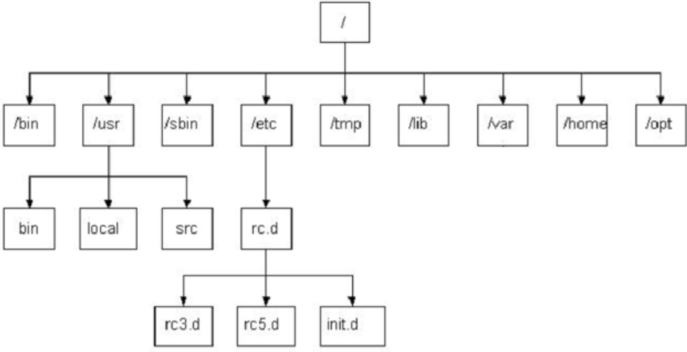
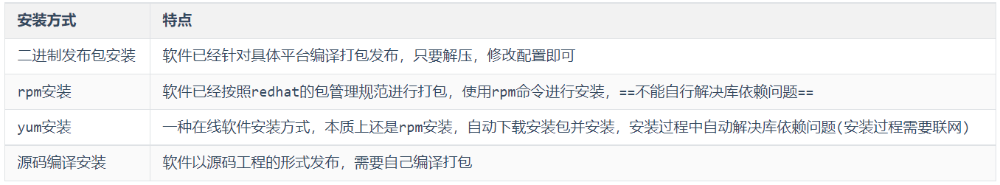

# Linux

## 一、目录结构
Linux的目录结构，如下：



根目录 / 下各个目录的作用及含义说明:  

| 编号 | 目录 | 含义                                        |
| :--- | :--- |:------------------------------------------|
| 1 | `/etc` | 存放系统配置文件                                  |
| 2 | `/home` | 普通用户主目录                                   |
| 3 | `/root` | 超级用户主目录                                   |
| 4 | `/tmp` | 存放临时文件                                    |
| 5 | `/usr` | 存放系统应用程序 `/usr/src/`                      |
| 6 | `/var` | 存放运行时需要改变数据的文件，例如 `/var/log`、`/var/cache` |
| 7 | `/bin` | 存放二进制可执行文件                                |
| 8 | `/sbin` | 存放二进制可执行文件，只有root用户才能访问                   |
| 9 | `/lib` | 存放程序运行所需的共享库和内核模块                         |
| 10 | `/dev` | 存放设备文件                                    |
| 11 | `/boot` | 存放系统启动相关文件                                |
| 12 | `/opt` | 第三方可选软件   `/opt/milvus`                   |

**总结**：配置在 `/etc`，程序在 `/usr`，日志在 `/var`，用户在 `/home`，命令在 `/bin`，管理在 `/sbin`，库在 `/lib`，设备在 `/dev`，进程信息在 `/proc`
- **绝对路径**：以 `/` 开头的路径，表示从根目录开始寻找
- **相对路径**：以 `.` 开头或者以 `../` 开头，通常都是从当前目录或者上级目录寻找


## 二、常用命令
### 2.1 文件与目录
```shell
ls          # 列出目录内容，如 ls -lh
cd          # 切换目录，如 cd /home/user
pwd         # 显示当前工作目录路径
mkdir       # 创建目录，如 mkdir -p a/b/c
touch       # 创建空文件，如 touch app.py
cp          # 复制文件/目录，如 cp -r src dst
mv          # 移动或重命名文件，如 mv old.txt new.txt
rm          # 删除文件/目录，如 rm -rf dir
find        # 按条件查找文件，如 find . -name "*.log"
ln          # 创建链接，如 ln -s /path link
```

### 2.2 内容查看与搜索
```shell
cat         # 查看文件全部内容，如 cat file.txt
tail        # 查看文件后 N 行/实时日志，如 tail -f app.log
grep        # 按关键字搜索文本，如 grep "error" app.log
vim         # 编辑文件，如 vim app.py
```

### 2.3 权限与用户
```shell
chmod       # 修改文件权限，如 chmod 755 run.sh
chown       # 修改文件所有者/组，如 chown user:group file
sudo        # 以管理员权限执行命令，如 sudo apt update
su          # 切换用户，如 su - root
id          # 查看当前用户信息，如 id
whoami      # 查看当前登录用户名
```

### 2.4 进程管理
```shell
ps          # 查看进程快照，如 ps aux
top         # 实时查看系统资源占用
kill        # 终止进程，如 kill PID
kill -9     # 强制终止进程，如 kill -9 PID
pkill       # 按名称终止进程，如 pkill nginx
```

### 2.5 网络相关
```shell
ping        # 测试网络连通性，如 ping www.example.com
curl        # 请求网络资源，如 curl -I https://example.com
wget        # 下载文件，如 wget https://example.com/file.zip
ip          # 查看网络地址，如 ip a
ss          # 查看端口监听，如 ss -tuln
ssh         # 远程登录服务器，如 ssh user@host
scp         # 安全传输文件，如 scp file user@host:/tmp
```

### 2.6 压缩解压
```shell
tar         # 打包/解压，如 tar -czvf app.tar.gz ./app
            # 解压：tar -xzvf app.tar.gz
zip         # 压缩为 zip，如 zip -r app.zip ./app
unzip       # 解压 zip，如 unzip app.zip
```

### 2.7 软件包管理
```shell
apt         # Debian/Ubuntu 包管理，如 apt install pkg
yum         # CentOS/RedHat/Fedora 包管理，如 yum install pkg
rpm         # CentOS/RedHat/Fedora 包管理，如 rpm -ivh pkg.rpm
```

### 2.8 其他工具
```shell
which       # 查找命令所在路径，如 which python3
history     # 查看历史命令
echo        # 输出文本或变量，如 echo $PATH
clear       # 清屏
```

## 三、软件安装



具体安装 uv、MySQL、Nginx 请参考：https://my.feishu.cn/wiki/RLsywWcgvicSHekggUOcWuhqnTb