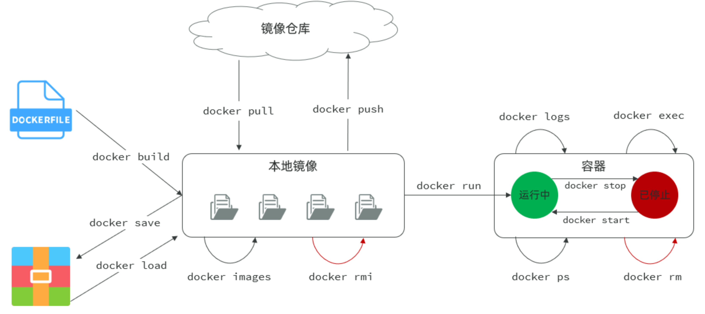

# Docker
## 一、学习目标
通过今天的学习，大家要能够达成下面的学习目标：
- 能利用 Docker 部署常见软件
- 能利用 Docker 打包并部署Python应用
- 理解 Docker 数据卷的基本作用
- 能看懂 Docker Compose 文件

## 二、安装 Docker 
### 2.1 Windows 安装 Docker
#### 下载 Docker 安装包

- 官网：[Install Docker Desktop on Windows](https://docs.docker.com/desktop/setup/install/windows-install/)

#### 安装到指定路径
- 使用管理员权限运行 `PowerShell`
- 切换到安装包所在目录
- 执行命令，以 `E:\Development_Tool\docker` 路径为例子
```shell
Start-Process 'Docker Desktop Installer.exe' -Wait -ArgumentList 'install', '--accept-license', '--installation-dir=E:\Development_Tool\docker', '--windows-containers-default-data-root=E:\Development_Tool\docker\windows-containers', '--wsl-default-data-root=E:\Development_Tool\docker\wsl'
```
#### 安装 mysql
```shell
docker run -d --name mysql -p 3306:3306 -e MYSQL_ROOT_PASSWORD=123 -e TZ=Asia/Shanghai mysql:8.0
```

#### 安装 redis-stack
```shell
docker run -d --name redis-stack -p 6379:6379 -p 8001:8001 redis/redis-stack:latest
```


### 2.2  Linux 安装 Docker
https://my.feishu.cn/wiki/Cl0RwQI3aiblEhkG05pcNbqtnec


## 三、Docker 基础
### 3.1 镜像和容器
当我们利用 Docker 安装应用时， Docker 会在**镜像仓库（Image Repository）**中自动搜索并下载应用的**镜像（Image）**。镜像不仅包含应用本身，还包含应用运行所需要的环境、配置、系统函数库。Docker 会在运行镜像时创建一个隔离环境，称为**容器（Container）**。
- 镜像（Image）：是容器的模板，包含运行容器所需的一切。
- 容器（Container）：是镜像的运行实例，每个容器都是一个独立的运行环境，互不干扰。Docker官方维护的公共仓库：[Docker Hub](https://hub.docker.com/)

- 镜像仓库（Image Repository）：存放镜像的仓库，可以理解为镜像的仓库地址。


### 3.2 命令解读
```shell
docker run               \    # 运行容器
-d                       \    # 后台运行
--name redis-stack       \    # 给容器命名, 必须唯一
-p 6379:6379             \    # 映射端口(本机端口：容器端口)，Redis
-p 8001:8001             \    # 映射端口(本机端口：容器端口)，RedisInsight
redis/redis-stack:latest \    # 镜像名称和版本 [repository]:[tag]
```
执行后：
- 程序可以通过 `localhost:6379` 连接 Redis；
- 浏览器可以打开 `http://localhost:8001` 使用 RedisInsight 管理数据。

### 3.3 常用命令



#### [操作镜像](https://docs.docker.com/reference/cli/docker/image/)
```shell
docker build  # [记忆] 构建镜像
docker pull   # 拉取镜像
docker push   # 推送镜像
docker images # [记忆] 列出镜像
docker rmi    # [记忆] 删除镜像

docker save  # 保存镜像
docker load  # 加载镜像
```

#### [操作容器](https://docs.docker.com/reference/cli/docker/container/)
```shell
docker run        # [记忆] 运行容器
docker ps -a      # [记忆] 列出容器
docker start      # 启动容器
docker stop       # 停止容器
docker restart    # 重启容器
docker rm         # 删除容器
docker logs       # 查看容器日志
docker exec -it   # 运行容器内命令
```


## 四、数据卷（volume）
**数据卷**（Volume）是 Docker 提供的一种数据外部存储方式，是**容器内目录**与**宿主机目录**之间映射的桥梁。数据卷独立于容器的生命周期，即使容器被删除，数据卷中的数据仍然保留。
- 数据卷管理更方便，可以方便的创建、删除、管理数据卷。 
- 数据卷独立于容器，容器删除后数据卷仍然保留。 
- 数据卷可以被多个容器同时使用。 
- 数据卷可以方便的进行数据备份、迁移。


因此，容器只是提供程序运行的环境，而**程序运行时产生的数据、程序运行依赖的配置都应该与容器解耦**。

### 4.1 Nginx 示例
以Nginx为例，我们知道Nginx中有两个关键的目录：
- `/etc/nginx/conf`: 配置文件
- `/usr/share/nginx/html`：静态资源


当我们创建数据卷的时候，Docker 会自动在宿主机上创建目录 `/var/lib/docker/volumes/[volume_name]/_data`，用于映射容器内的目录。

> 为什么不让容器目录直接指向宿主机目录呢，而是创建数据卷？
> - 数据卷相当于中间桥梁，有了数据卷之后，容器和宿主机之间就解耦了，容器只需要知道数据卷的名称，而不需要知道数据卷具体映射到宿主机的目录。
> - 解耦之后，数据卷就可以方便的进行数据备份、迁移。


### 4.2 挂载方式对比
| 方式               | 说明 | 适合场景 |
|------------------|---|---|
| Volume（数据卷）      | Docker 管理的命名卷，默认存在 `/var/lib/docker/volumes/` | 数据库、日志、持久化数据 |
| Bind Mount（本地目录） | 挂载宿主机指定目录到容器 | 开发时同步代码、挂载配置文件 |

Volume
```shell
# docker volume create html # 没必要手动创建数据卷，因为当创建容器时，遇到数据卷不存在的情况，Docker会自动创建数据卷
docker run -d --name nginx -p 80:80 -v html:/usr/share/nginx/html nginx:latest
```

Bind Mout
```shell
mkdir -p ./html
docker run -d --name nginx -p 80:80 -v ./html:/usr/share/nginx/html nginx:latest
```

### 4.3 常用命令
```shell
docker volume create  # 创建数据卷
docker volume ls      # 列出数据卷
docker volume rm      # 删除数据卷
docker volume inspect # 查看数据卷详情
docker volume prune   # 删除所有未使用的数据卷
```

### 4.4 教学演示
Nginx挂载数据卷
```shell
docker run -d --name nginx -p 80:80 \
-v html:/usr/share/nginx/html \
-v conf:/etc/nginx/conf \
nginx:latest
docker volume ls 
docker volume inspect html

# 进入目录，修改静态资源
cd /var/lib/docker/volumes/html/_data
vi index.html
```

MySQL挂载本地目录
```shell
docker run -d --name mysql -p 3306:3306 \
-e MYSQL_ROOT_PASSWORD=123 -e TZ=Asia/Shanghai   \ 
-v ./root/mysql/data:/var/lib/mysql              \   # 数据目录
-v ./root/mysql/conf:/etc/mysql/conf.d           \  # 配置文件
-v ./root/mysql/init:/docker-entrypoint-initdb.d \  # 初始化脚本
mysql:8.0
```

## 五、自定义镜像
### 5.1 镜像结构
自定义镜像本质就是依次准备好**程序运行的环境、依赖、应用本身、运行配置等文件**，并且打包而成

构建一个Python镜像的步骤：
1. Linux 运行环境
2. 安装 Python、UV
3. 拷贝 Python 源码
4. 编写启动脚本


### 5.2 Dockerfile


## 六、Docker Compose
