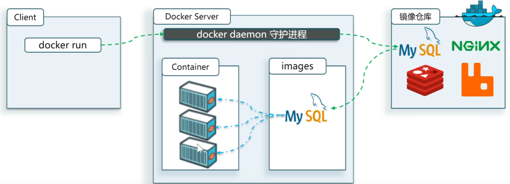

# Docker
## 一、学习目标
通过今天的学习，大家要能够达成下面的学习目标：
- 能利用 Docker 部署常见软件
- 能利用 Docker 打包并部署Python应用
- 理解 Docker 数据卷的基本作用
- 能看懂 Docker Compose 文件

## 二、安装 Docker 
### 2.1 Windows 安装 Docker
#### 下载 Docker 安装包

- 官网：[Install Docker Desktop on Windows](https://docs.docker.com/desktop/setup/install/windows-install/)

#### 安装到指定路径
- 使用管理员权限运行 `PowerShell`
- 切换到安装包所在目录
- 执行命令，以 `E:\Development_Tool\docker` 路径为例子
```shell
Start-Process 'Docker Desktop Installer.exe' -Wait -ArgumentList 'install', '--accept-license', '--installation-dir=E:\Development_Tool\docker', '--windows-containers-default-data-root=E:\Development_Tool\docker\windows-containers', '--wsl-default-data-root=E:\Development_Tool\docker\wsl'
```
#### 安装 mysql
```shell
docker run -d --name mysql -p 3306:3306 -e MYSQL_ROOT_PASSWORD=123 -e TZ=Asia/Shanghai mysql:8.0
```

#### 安装 redis-stack
```shell
docker run -d --name redis-stack -p 6379:6379 -p 8001:8001 redis/redis-stack:latest
```


### 2.2  Linux 安装 Docker
https://my.feishu.cn/wiki/Cl0RwQI3aiblEhkG05pcNbqtnec


## 三、Docker 基础
### 3.1 镜像和容器
当我们利用 Docker 安装应用时， Docker 会在**镜像仓库（Image Repository）**中自动搜索并下载应用的**镜像（Image）**。镜像不仅包含应用本身，还包含应用运行所需要的环境、配置、系统函数库。Docker 会在运行镜像时创建一个隔离环境，称为**容器（Container）**。
- 镜像（Image）：是容器的模板，包含运行容器所需的一切。
- 容器（Container）：是镜像的运行实例，每个容器都是一个独立的运行环境，互不干扰。Docker官方维护的公共仓库：[Docker Hub](https://hub.docker.com/)

- 镜像仓库（Image Repository）：存放镜像的仓库，可以理解为镜像的仓库地址。



### 3.2 命令解读
```shell
docker run               \    # 运行容器
-d                       \    # 后台运行
--name redis-stack       \    # 给容器命名, 必须唯一
-p 6379:6379             \    # 映射端口(本机端口：容器端口)，Redis
-p 8001:8001             \    # 映射端口(本机端口：容器端口)，RedisInsight
redis/redis-stack:latest \    # 镜像名称和版本 [repository]:[tag]
```
执行后：
- 程序可以通过 `localhost:6379` 连接 Redis；
- 浏览器可以打开 `http://localhost:8001` 使用 RedisInsight 管理数据。

### 3.3 常用命令


#### [操作镜像](https://docs.docker.com/reference/cli/docker/image/)
```shell
docker build  # [记忆] 构建镜像
docker pull   # 拉取镜像
docker push   # 推送镜像
docker images # [记忆] 列出镜像
docker rmi    # [记忆] 删除镜像

docker save  # 保存镜像
docker load  # 加载镜像
```

#### [操作容器](https://docs.docker.com/reference/cli/docker/container/)
```shell
docker run        # [记忆] 运行容器
docker ps -a      # [记忆] 列出容器
docker start      # 启动容器
docker stop       # 停止容器
docker restart    # 重启容器
docker rm         # 删除容器
docker logs       # 查看容器日志
docker exec -it   # 运行容器内命令
```


### 3.4 数据卷（volume）

容器提供程序的运行环境，但是 程序运行产生的数据、程序运行依赖的配置都应该与容器解耦

## 四、Docker Compose
