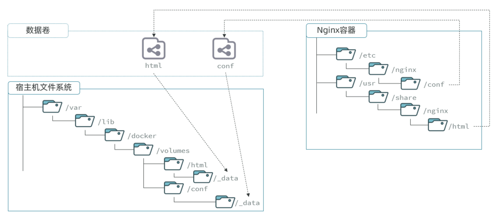
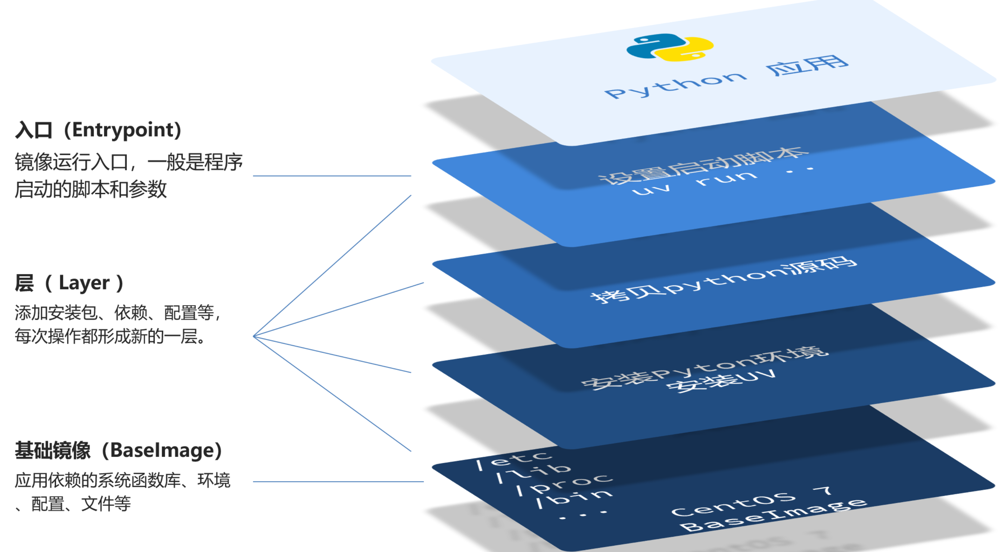

# Docker
## 一、学习目标
通过今天的学习，大家要能够达成下面的学习目标：
- 能利用 Docker 部署常见软件
- 能利用 Docker 打包并部署Python应用
- 理解 Docker 数据卷的基本作用
- 能看懂 Docker Compose 文件

## 二、安装 Docker 
### 2.1 Windows 安装 Docker
#### 下载 Docker 安装包

- 官网：[Install Docker Desktop on Windows](https://docs.docker.com/desktop/setup/install/windows-install/)

#### 安装到指定路径
- 使用管理员权限运行 `PowerShell`
- 切换到安装包所在目录
- 执行命令，以 `E:\Development_Tool\docker` 路径为例子
```shell
Start-Process 'Docker Desktop Installer.exe' -Wait -ArgumentList 'install', '--accept-license', '--installation-dir=E:\Development_Tool\docker', '--windows-containers-default-data-root=E:\Development_Tool\docker\windows-containers', '--wsl-default-data-root=E:\Development_Tool\docker\wsl'
```
#### 安装 mysql
```shell
docker run -d --name mysql -p 3306:3306 -e MYSQL_ROOT_PASSWORD=123 -e TZ=Asia/Shanghai mysql:8.0
```

#### 安装 redis-stack
```shell
docker run -d --name redis-stack -p 6379:6379 -p 8001:8001 redis/redis-stack:latest
```


### 2.2  Linux 安装 Docker
https://my.feishu.cn/wiki/Cl0RwQI3aiblEhkG05pcNbqtnec


## 三、Docker 基础
### 3.1 镜像和容器
当我们利用 Docker 安装应用时， Docker 会在**镜像仓库（Image Repository）**中自动搜索并下载应用的**镜像（Image）**。镜像不仅包含应用本身，还包含应用运行所需要的环境、配置、系统函数库。Docker 会在运行镜像时创建一个隔离环境，称为**容器（Container）**。
- 镜像（Image）：是容器的模板，包含运行容器所需的一切。
- 容器（Container）：是镜像的运行实例，每个容器都是一个独立的运行环境，互不干扰。Docker官方维护的公共仓库：[Docker Hub](https://hub.docker.com/)

- 镜像仓库（Image Repository）：存放镜像的仓库，可以理解为镜像的仓库地址。


### 3.2 命令解读
```shell
docker run               \    # 运行容器
-d                       \    # 后台运行
--name redis-stack       \    # 给容器命名, 必须唯一
-p 6379:6379             \    # 映射端口(本机端口：容器端口)，Redis
-p 8001:8001             \    # 映射端口(本机端口：容器端口)，RedisInsight
redis/redis-stack:latest \    # 镜像名称和版本 [repository]:[tag]
```
执行后：
- 程序可以通过 `localhost:6379` 连接 Redis；
- 浏览器可以打开 `http://localhost:8001` 使用 RedisInsight 管理数据。

### 3.3 常用命令


#### [操作镜像](https://docs.docker.com/reference/cli/docker/image/)
```shell
docker build  # [记忆] 构建镜像
docker pull   # 拉取镜像
docker push   # 推送镜像
docker images # [记忆] 列出镜像
docker rmi    # [记忆] 删除镜像

docker save  # 保存镜像
docker load  # 加载镜像
```

#### [操作容器](https://docs.docker.com/reference/cli/docker/container/)
```shell
docker run        # [记忆] 运行容器
docker ps -a      # [记忆] 列出容器
docker start      # 启动容器
docker stop       # 停止容器
docker restart    # 重启容器
docker rm         # 删除容器
docker logs       # 查看容器日志
docker exec -it   # 运行容器内命令
```


## 四、数据卷（volume）
**数据卷**（Volume）是 Docker 提供的一种数据外部存储方式，是**容器内目录**与**宿主机目录**之间映射的桥梁。数据卷独立于容器的生命周期，即使容器被删除，数据卷中的数据仍然保留。
- 数据卷管理更方便，可以方便的创建、删除、管理数据卷。 
- 数据卷独立于容器，容器删除后数据卷仍然保留。 
- 数据卷可以被多个容器同时使用。 
- 数据卷可以方便的进行数据备份、迁移。


因此，容器只是提供程序运行的环境，而**程序运行时产生的数据、程序运行依赖的配置都应该与容器解耦**。

### 4.1 Nginx 示例
以Nginx为例，我们知道Nginx中有两个关键的目录：
- `/etc/nginx/conf`: 配置文件
- `/usr/share/nginx/html`：静态资源



当我们创建数据卷的时候，Docker 会自动在宿主机上创建目录 `/var/lib/docker/volumes/[volume_name]/_data`，用于映射容器内的目录。

> 为什么不让容器目录直接指向宿主机目录呢，而是创建数据卷？
> - 数据卷相当于中间桥梁，有了数据卷之后，容器和宿主机之间就解耦了，容器只需要知道数据卷的名称，而不需要知道数据卷具体映射到宿主机的目录。
> - 解耦之后，数据卷就可以方便的进行数据备份、迁移。


### 4.2 挂载方式对比
| 方式               | 说明 | 适合场景 |
|------------------|---|---|
| Volume（数据卷）      | Docker 管理的命名卷，默认存在 `/var/lib/docker/volumes/` | 数据库、日志、持久化数据 |
| Bind Mount（本地目录） | 挂载宿主机指定目录到容器 | 开发时同步代码、挂载配置文件 |

Volume
```shell
# docker volume create html # 没必要手动创建数据卷，因为当创建容器时，遇到数据卷不存在的情况，Docker会自动创建数据卷
docker run -d --name nginx -p 80:80 -v html:/usr/share/nginx/html nginx:latest
```

Bind Mout
```shell
mkdir -p ./html
docker run -d --name nginx -p 80:80 -v ./html:/usr/share/nginx/html nginx:latest
```

### 4.3 常用命令
```shell
docker volume create  # 创建数据卷
docker volume ls      # 列出数据卷
docker volume rm      # 删除数据卷
docker volume inspect # 查看数据卷详情
docker volume prune   # 删除所有未使用的数据卷
```

### 4.4 教学演示
Nginx挂载数据卷
```shell
docker run -d --name nginx -p 80:80 \
-v html:/usr/share/nginx/html \
-v conf:/etc/nginx/conf \
nginx:latest
docker volume ls 
docker volume inspect html

# 进入目录，修改静态资源
cd /var/lib/docker/volumes/html/_data
vi index.html
```

MySQL挂载本地目录
```shell
docker run -d --name mysql -p 3306:3306 \
-e MYSQL_ROOT_PASSWORD=123 -e TZ=Asia/Shanghai   \ 
-v ./root/mysql/data:/var/lib/mysql              \   # 数据目录
-v ./root/mysql/conf:/etc/mysql/conf.d           \  # 配置文件
-v ./root/mysql/init:/docker-entrypoint-initdb.d \  # 初始化脚本
mysql:8.0
```

## 五、自定义镜像
### 5.1 镜像结构
自定义镜像本质就是依次准备好**程序运行的环境、依赖、应用本身、运行配置等文件**，并且打包而成

构建一个Python镜像的步骤：
1. Linux 运行环境
2. 安装 Python、UV
3. 拷贝 Python 源码
4. 编写启动脚本



### 5.2 Dockerfile
用 Dockerfile 来描述每层内容，Docker 会根据 Dockerfile 生成镜像

| 指令 | 说明 | 示例 |
| :--- | :--- | :--- |
| **FROM** | 指定基础镜像 | `FROM centos:7` |
| **ENV** | 设置环境变量，可在后面指令使用 | `ENV key value` |
| **COPY** | 拷贝本地文件到镜像的指定目录 | `COPY ./hm.tar /tmp` |
| **RUN** | 执行Linux的shell命令，一般是安装过程的命令 | `RUN tar -xvf /tmp/hm.tar && pip install uv && uv sync` |
| **EXPOSE** | 指定容器运行时监听的端口，是给镜像使用者看的 | `EXPOSE 8000` |
| **ENTRYPOINT** | 镜像中应用的启动命令，容器运行时调用 | `ENTRYPOINT uv run xxx` |

例如，要基于 python:3.12-slim 镜像来构建一个 Python 应用，其 Dockerfile 内容如下：
```dockerfile
# 使用 python:3.12-slim 作为基础镜像
From python:3.12-slim
# 设置应用目录
WORKDIR /app 
# 安装 uv
COPY --from=ghcr.io/astral-sh/uv:latest /uv /usr/local/bin/uv
# 拷贝依赖管理文件
COPY pyproject.toml ./
# 安装依赖
RUN uv sync --no-dev
# 拷贝源码
COPY src/ ./src/
# 暴露端口
EXPOSE 8000
# 运行命令
ENTRYPOINT ["uv", "run", "uvicorn", "src.main:app", "--host", "0.0.0.0", "--port", "8000"]
```

Dockerfile文件编写好了之后，就可以使用如下命令来构建镜像了。
```shell
docker build -t [镜像名]:[标签] .
```
- `-t [repository]:[tag]`：是给镜像起名，不指定tag时，默认为latest
- `.`：是指定Dockerfile所在目录，如果就在当前目录，则指定为"."

```shell
docker build -t backend .
docker run -d --name backend -p 8000:8000 backend --env-file .env.prod
```

## 六、网络互联
### 6.1 基础命令
| 命令 | 说明 |
| :--- | :--- |
| `docker network create` | 创建一个网络 |
| `docker network ls` | 查看所有网络 |
| `docker network rm` | 删除指定网络 |
| `docker network prune` | 清除未使用的网络 |
| `docker network connect` | 使指定容器连接加入某网络 |
| `docker network disconnect` | 使指定容器连接离开某网络 |
| `docker network inspect` | 查看网络详细信息 |


### 6.2 教学演示
```shell
docker network create my_network
docker network ls
docker network connect my_network backend
docker network connect my_network mysql
docker network connect my_network nginx
```

再重新创建 backend，并且加入网络
```shell
docker run --name backend -p 8000:8000 --env-file .env.prod --network my_network -d backend
```

## 七、Docker Compose
Docker Compose就可以帮助我们实现**多个相互关联的Docker容器的快速部署**

### 7.1 基础语法

| docker run 参数 | docker compose 指令 | 说明 |
| :--- | :--- | :--- |
| `--name` | `container_name` | 容器名称 |
| `-p` | `ports` | 端口映射 |
| `-e` | `environment` | 环境变量 |
| `-v` | `volumes` | 数据卷配置 |
| `--network` | `networks` | 网络 |

举例来说，用docker run部署Nginx的命令如下：

```shell
docker run -d \
 --name chatbot-frontend\
 -v /root/robot/frontend/public:/usr/share/nginx/html \
 -v /root/robot/frontend/nginx.conf:/etc/nginx/nginx.conf \
 --network my_network \
 -p 80:80 \
nginx:latest
```

如果用 `docker-compose.yml` 文件来定义，就是这样：

```yaml
services:
  frontend:
    image: "nginx:latest"
    container_name: chatbot-frontend
    ports:
      - "80:80"
    volumes:
      - "/root/robot/frontend/public:/usr/share/nginx/html"
      - "/root/robot/frontend/nginx.conf:/etc/nginx/nginx.conf"
    networks:
      - my_network
networks:
  my_network:
    name: my_network
```
### 7.2 基础命令
编写好 `docker-compose.yml` 文件，就可以部署项目了。语法如下：
```shell
docker compose [OPTIONS] [COMMAND]
```
其中，OPTIONS和COMMAND都是可选参数，比较常见的有：

| 类型 | 参数或指令 | 说明 |
| :--- | :--- | :--- |
| Options | `-f` | 指定compose文件的路径和名称 |
| Options | `-p` | 指定project名称。project就是当前compose文件中设置的多个service的集合，是逻辑概念 |
| Commands | `up` | 创建并启动所有service容器 |
| Commands | `down` | 停止并移除所有容器、网络 |
| Commands | `ps` | 列出所有启动的容器 |
| Commands | `logs` | 查看指定容器的日志 |
| Commands | `stop` | 停止容器 |
| Commands | `start` | 启动容器 |
| Commands | `restart` | 重启容器 |
| Commands | `top` | 查看运行的进程 |
| Commands | `exec` | 在指定的运行中容器中执行命令 |

### 7.3 教学演示
```yaml
services:
  mysql:
    image: mysql:8.0
    container_name: chatbot-mysql
    environment:
      MYSQL_ROOT_PASSWORD: 123456
      MYSQL_DATABASE: robot
    ports:
      - "3306:3306"
    volumes:
      - mysql_data:/var/lib/mysql
    healthcheck:
      test: ["CMD", "mysqladmin", "ping", "-h", "localhost"]
      interval: 10s
      timeout: 5s
      retries: 5

  backend:
    build: ./backend
    container_name: chatbot-backend
    ports:
      - "8000:8000"
    env_file:
      - .env.prod
    depends_on:
      mysql:
        condition: service_healthy

  frontend:
    image: nginx:latest
    container_name: chatbot-frontend
    ports:
      - "80:80"
    volumes:
      - ./frontend/nginx.conf:/etc/nginx/conf.d/default.conf:ro
      - ./frontend/public:/usr/share/nginx/html:ro
    depends_on:
      - backend

volumes:
  mysql_data:
```

```shell
docker compose up -d
```
