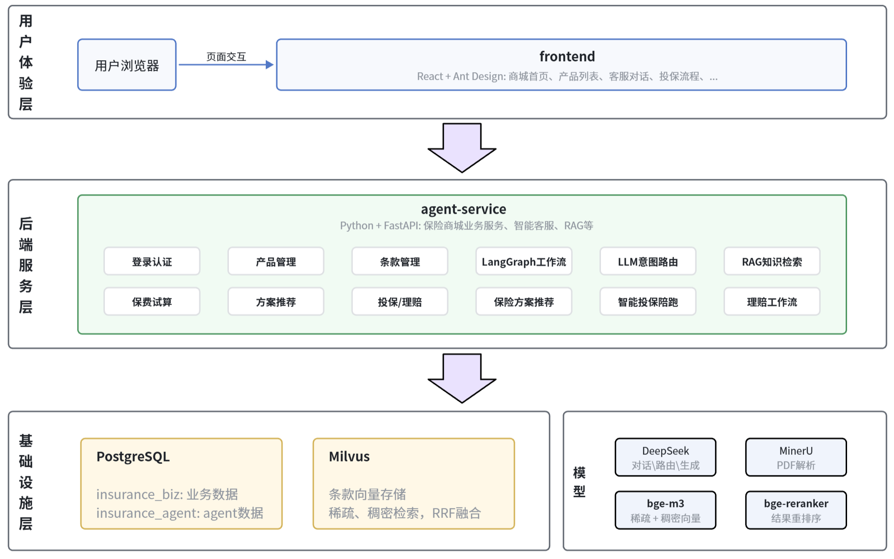

# 项目介绍与环境准备
## 一、学习目标
- 能说出项目背景和系统架构
- 会用 Docker Compose 启动基础设施

## 二、项目背景和系统架构

### 2.1 项目背景
普通用户对保险产品了解有限，面对众多保险产品和复杂的保险条款，难以做出明智的决策
- 自己应该买哪几类保险？
- 每类保险买哪个产品？
- 这些保险条款是什么意思？
- 条款里哪些内容影响理赔？

「**安心保**」是一个在线保险商城，集合了各大保险公司的保险产品，让用户可以一站式构筑自己的保险组合，其中包含一个AI智能保险顾问，可以协助用户选购保险、产品答疑、解释条款、指引理赔等服务


保险产品认知：
- 百万医疗保险（"报销型"）：解决大病医疗费用，社保报完剩下一万以上的部分，凭发票报销，最高能报几百万
- 重疾险（"给付型"）：确诊合同约定的大病后，直接赔付一笔现金
- 寿险（"责任型"）：在保障期间内身故或全残，赔付一笔钱给家人。主要防止家庭经济支柱突然倒下，房贷、子女教育、老人赡养无法维系
- 意外险（"伤残型"）：发生意外事故后，根据伤残程度赔付一笔钱，并报销意外导致的医疗费

### 2.2 系统架构



- frontend（前端）——已就绪，我们无需开发<br>
React + Ant Design，提供保险商城界面和客服对话框。我们只需要关心它发给 agent-service 的请求格式。
- agent-service（后端）——未完成，需要我们开发<br>
  基于 Python FastAPI 编写，负责传统后端工作以及 Agent 和 RAG 开发。
  - 业务部分：
    - 用户注册登录
    - 产品查询
    - 保费计算
    - 保单管理
    - 理赔记录
    - ...
  - Agent部分：
    - 接收用户消息，理解意图（想买保险？想理赔？还是随便聊聊？）
    - 检索保险条款知识库（RAG，后续章节实现）
    - 调用工具（查产品、算保费、生成产品推荐方案）
    - 用大模型生成自然语言回复，流式推送给前端

### 2.3 技术栈
| 层 | 技术 |
| :--- | :--- |
| Web 框架 | FastAPI |
| AI 编排 | LangGraph (状态图) + LangChain (模型/工具/消息) |
| 大模型 | DeepSeek (通过 OpenAI 兼容接口) |
| 向量数据库 | Milvus 2.6 |
| 关系数据库 | PostgreSQL 16 |
| 前端 | React + Ant Design |
| 包管理 | uv |
| 部署 | Docker Compose |


## 三、环境准备
| 服务 | 端口 | 用途 |
| :--- | :--- | :--- |
| PostgreSQL | 5432 | 存储业务数据和对话历史，默认DB：insurance，用户名：insurance/insurance123 |
| Milvus | 19530 | 向量存储与检索 |
| etcd | 2379 | Milvus 依赖的元数据存储 |
| MinIO | 9000/9001 | Milvus 依赖的对象存储 |
| attu | 3000 | Milvus 的图形界面工具 |


### 3.1 一键部署 postgres 和 milvus

#### 一键部署
修改 `./deploy/milvus/user.yaml` 中 `dashscope_apikey` 的值
```shell
docker compose up -d
```

#### 连接 postgres
- 数据库名：insurance
- 用户名：insurance
- 密码：insurance123

#### 连接 Milvus
Milvus有一个web控制台，端口是3000，在浏览器输入地址：http://localhost:3000 即可访问

首次访问，需要注册一个管理员的用户名和密码，密码必须8位以上，且必须有大写、小写、数字、下划线中的3个类型。admin/admin_123

### 3.2 部署前端
放在一个路径不含中文的目录下，然后执行命令，安装依赖，
```shell
npm install
```

再执行命令， 启动前端，通过 http://localhost:5173 访问
```shell
npm run dev
```
