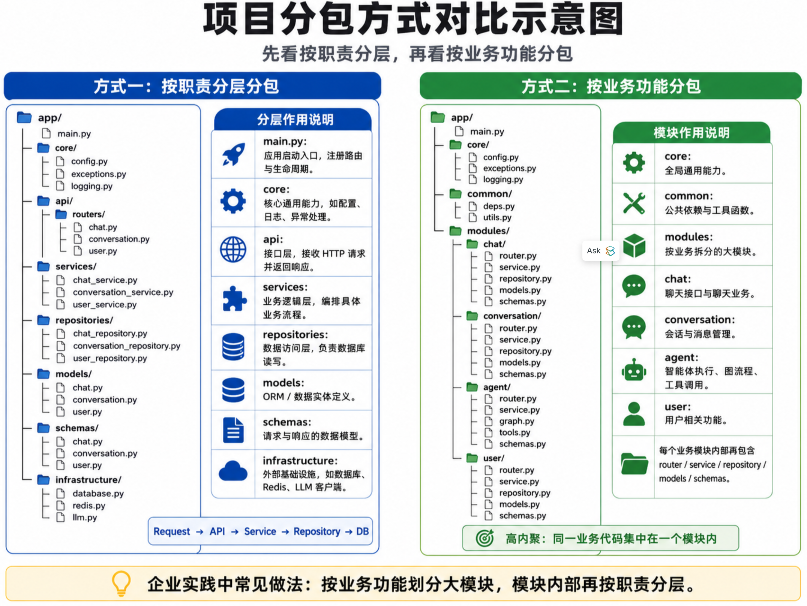
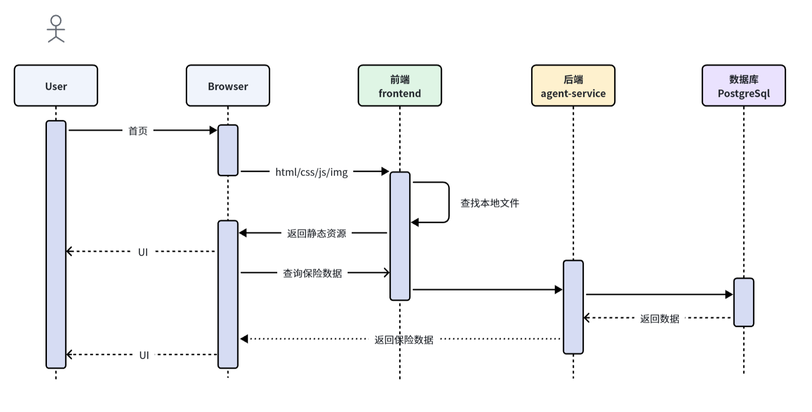

## 学习目标
- 理解项目结构和 pydantic-settings 配置管理
- 能使用 FastAPI 的生命周期管理数据库连接
- 能使用 SqlAlchemy 实现保险查询功能

## 项目初始化

### 一、项目结构
项目按照职责划分不同的包和模块
- core：核心模块
- infra：基础设施模块
- common：通用模块
- modules：业务模块，主要实现数据库的CRUD以及与前端交互


业务模块再按照处理前端请求的流程划分，通常流程如下图所示：


常见的项目结构有两种：




本项目是按照**业务功能**来划分包结构。

### 二、配置管理 `pydantic-setting`

在开发过程中通常会在项目中用 `.env` 文件来配置项目关键参数，而在部署时才用`系统环境变量`、`命令行参数`来替换

通常我们用 `pydantic-settings` 来管理这些配置，安装依赖
```shell
uv add pydantic-settings
```

配置信息举例
- 项目端口、项目名称
- DeepSeek密钥、Deepseek地址
- 数据库地址、数据库端口、数据库用户名、数据库密码、数据库名
- 日志级别
- ...


#### 2.1 配置加载优先级

如果多种不同的配置同时存在，其加载顺序和优先级如下图：


#### 2.2 配置 `.env`
在项目根目录下创建一个 `.env` 文件，添加如下内容：
```dotenv
# 应用配置
APP_NAME=安心保
APP_DEBUG=true
APP_HOST=0.0.0.0
APP_PORT=8001

# 日志配置
LOGGING_LEVEL=INFO

# 数据库配置
DB_HOST=192.168.150.101
DB_PORT=5432
DB_NAME=insurance
DB_USER=insurance
DB_PASSWORD=insurance123

# 模型配置
DEEPSEEK_API_KEY=your_deepseek_api_key  # 需要替换！！！
CHAT_MODEL=deepseek-v4-flash
```

#### 2.3 配置加载
在 `app.core` 包下创建一个 `config.py` 文件，添加如下内容：
```
见 `app.core.config` 
```

### 三、日志管理
在 `app.core` 包下创建一个 `logging.py` 文件，添加如下内容：
```
见 `app.core.logging` 
```

### 四、项目启动模块

我们在 `app` 包下写一个启动类 `main.py`

启动测试：访问 `http://localhost:8001/docs` ，可以看到 FastAPI 提供的文档

### 五、数据库连接池

#### 5.1 补充连接池配置参数 `echo`、`pool_size`、`max_overflow`、`pool_recycle`
首先，我们在 `app.core.config.py` 中添加数据库连接池相关参数：
```python
class DatabaseSettings(EnvSettings):
    """数据库相关设置"""
    host: str = Field(alias="DB_HOST", default="localhost")
    port: int = Field(alias="DB_PORT", default=5432)
    name: str = Field(alias="DB_NAME", default="insurance")
    user: str = Field(alias="DB_USER", default="insurance")
    password: str = Field(alias="DB_PASSWORD", default="insurance123")
    echo: bool = Field(alias="DB_ECHO", default=False)                         ### 新增
    pool_size: int = Field(alias="DB_POOL_SIZE", default=5)                    ### 新增
    max_overflow: int = Field(alias="DB_MAX_OVERFLOW", default=10)             ### 新增
    pool_recycle: int = Field(alias="DB_POOL_RECYCLE", default=1800)           ### 新增

    @computed_field
    @property
    def url(self) -> str:
        # 自动拼接URL路径
        return PostgresDsn.build(
            scheme="postgresql+asyncpg",
            host=self.host,
            port=self.port,
            username=self.user,
            password=self.password
        ).encoded_string()
```

#### 5.2 统一管理连接池
数据库连接池需要统一管理，然后通过**依赖注入**的方式给每个用户请求分发连接，连接断开后自动释放连接

在项目根目录下新建一个 `app.infra` 包，然后新建一个 `database.py` 文件，添加以下代码
```
见 app.infra.database.py
```

#### 5.2 生命周期管理

由于连接池默认是懒加载，第一次反问才会初始化
所以，我们需要再项目启动时初始化数据库连接池（调用 `check_database`）,在项目停止的时候关闭连接池（调用 `close_db`）

修改 `app.main.py`, 添加下面逻辑

```python
from contextlib import asynccontextmanager

# 生命周期管理（预留）
@asynccontextmanager
async def lifespan(app: FastAPI):
    logger.info(f"【{settings.app.name}】应用启动中...")
    from app.infra.database import check_database, close_database
    try:
        await check_database()
        yield
    finally:
        logger.info("应用关闭中... ")
        await close_database()

app = FastAPI(
    title=settings.app.name,
    debug=settings.app.debug,
    lifespan=lifespan,                
)
```

## 业务开发

### 一、开发规范

#### 1.1 前后端分离架构
- **前端**：负责渲染页面，展示数据
- **后端**：负责提供前端展示所需的数据，例如商品信息、用户信息等



#### 1.2 接口文档
- [保险业务接口文档](https://my.feishu.cn/wiki/VCv6wzhr2i94KCkj7Bwc4GkdnNc)：与保险相关的业务接口，如登录、注册、保险商品查询等
- [智能客服接口文档](https://my.feishu.cn/wiki/XxdQwOlDpiaRRMk2thYcVEOKnte)：与AI智能客服相关接口，如会话管理、对话聊天等

当然，完整的保险业务接口非常多，我们并不需要全都开发，目前只需要做下面几个与保险产品（Product）有关的接口：
- **6.1.查询产品列表**
- **6.2.查询推荐候选产品**

后续可以继续完成其它接口

#### 1.3 开发流程

业务功能放到 `app.modules` 包中，不同业务创建子包
- 产品接口：`product`
- 认证接口：`auth`
- 保费测算接口：calculate
- 保险方案接口：insurance-plans
- 保单接口：policies
- 理赔接口：claims
- 订单接口：orders

在每个子包下，又包含 `schemas`、`router`、`service`、`repository`、`models`等模块，模块间的关系如下：


- `schemas` 是按照接口文档规范定义的请求和响应约束模型
- `models` 是数据库表映射类，这两类数据在各层间传递，需要先定义出来
- 开发业务时从底层的 `repository` 开始，逐层向上开发

### 二、产品接口

#### 2.1 查询产品列表
##### Models
`products` 表的 DDL 语句见 `products.sql`, 参考表结构来定义 model 即可


首先先统一SQLAlchemy的基类和混入类，创建 `app.common.models` 文件，并添加以下内容：
```python
from sqlalchemy.orm import DeclarativeBase, Mapped, mapped_column
from datetime import datetime
from sqlalchemy import DateTime, func

# SQLAlchemy的基类，所有数据库表模型都必须继承
class Base(DeclarativeBase):
    def __repr__(self) -> str:
        """通用的repr函数，用于控制台输出对象信息"""
        # 获取当前类名
        cls_name = self.__class__.__name__
        # 保存属性 key（属性）：value（值）
        attrs = {}
        # 遍历对象的所有属性
        for key, val in vars(self).items():
            # 过滤掉 SQLAlchemy 内部以 _ 开头的私有属性
            if key.startswith("_"):
                continue
            # 时间类型格式化
            if isinstance(val, datetime):
                attrs[key] = val.strftime("%Y-%m-%d %H:%M:%S")
            else:
                attrs[key] = val
        # 拼成最终字符串，如：Product({'id': 1, 'name': '重疾险A', ...})
        return f"{cls_name}({attrs})"

# 通用的时间戳【混入类】，这样其它数据模型不用重复定义时间相关字段
class CreateAtMixin:
    # func.now() 会让数据库在插入时自动生成服务器时间（如 PostgreSQL 的 NOW()）
    created_at: Mapped[datetime] = mapped_column(DateTime(timezone=True), nullable=False, server_default=func.now(), comment="创建时间")

class UpdateAtMixin:
    # onupdate=func.now() 会在每次数据行被 UPDATE 时，由 SQLAlchemy 自动更新该字段
    updated_at: Mapped[datetime] = mapped_column(DateTime(timezone=True), nullable=False, server_default=func.now(), onupdate=func.now(), comment="最后更新时间")
```
定义 products 表的 ORM 模型，创建 `app.module.product.models` 文件，并添加以下内容：
```python
from decimal import Decimal
from sqlalchemy import Index, BigInteger, String, Text, Numeric, ARRAY, CheckConstraint
from sqlalchemy.orm import Mapped, mapped_column
from app.common.models import Base, CreateAtMixin, UpdateAtMixin


""" 产品表的 ORM 模型 """
class Products(Base, CreateAtMixin, UpdateAtMixin):

    __tablename__ = 'products'

    # 创建索引
    __table_args__ = (
        CheckConstraint("category IN ('medical', 'critical_illness', 'accident', 'life')", name="chk_products_category"),
        Index("idx_products_category", "category"),
        Index("idx_products_status", "status"),
        {"comment": "保险商城在售及历史保险产品"}
    )

    id: Mapped[int] = mapped_column(BigInteger, primary_key=True, comment="产品主键")
    name: Mapped[str] = mapped_column(String(200), nullable=False, comment="商城展示名称")
    clause_name: Mapped[str] = mapped_column(String(300), nullable=False, comment="主条款文件名，包含 .pdf 后缀")
    category: Mapped[str] = mapped_column(String(50), nullable=False, comment="险种分类：医疗、重疾、意外或寿险")
    insurer: Mapped[str] = mapped_column(String(120), nullable=False, comment="承保保险公司")

    image_url: Mapped[str | None] = mapped_column(Text, comment="产品展示图片地址")
    description: Mapped[str| None] = mapped_column(Text, comment="产品简介")
    min_premium: Mapped[Decimal | None] = mapped_column(Numeric(14, 2), comment="产品公开的最低年缴保费参考")
    max_premium: Mapped[Decimal | None] = mapped_column(Numeric(14, 2), comment="产品公开的最高保费参考，可为空")
    target_group: Mapped[str| None] = mapped_column(String(300), comment="适用人群说明")
    highlights: Mapped[list[str] | None] = mapped_column(ARRAY(Text), comment="产品亮点列表")
    status: Mapped[str] = mapped_column(String(30), nullable=False, default="active", comment="产品状态")
    # created_at: Mapped[datetime] = mapped_column(DateTime(timezone=True), nullable=False, server_default=func.now(), comment="创建时间")
    # updated_at: Mapped[datetime] = mapped_column(DateTime(timezone=True), nullable=False, server_default=func.now(), onupdate=func.now(), comment="最后更新时间")
```
> 注意：金额字段在数据库中是 `NUMERIC(14, 2)`，Model 使用 `Decimal` 可以避免浮点误差

##### Repository
Repository 只负责数据库访问——crud 操作，不涉及任何业务逻辑

创建 `app.module.product.repository` 文件，并添加以下内容：
```python
from sqlalchemy import select
from sqlalchemy.ext.asyncio import AsyncSession
from app.modules.product.models import Products

""" 需求1：查询产品列表 """
class ProductRepository:
    def __init__(self, db: AsyncSession):
        self.db = db

    async def find_by_category(self, category: str | None = None) -> list[Products]:
        # 1.组装查询条件
        # 1.1.默认只查询active状态的产品
        conditions = [Products.status == "active"]
        # 1.2.如果有category，则添加category过滤
        if category:
            conditions.append(Products.category == category)

        # 2.查询产品列表
        query = select(Products).where(*conditions).order_by(Products.id.asc())
        products = await self.db.scalars(query)
        return products.all()
```

##### Service
Service 层负责业务逻辑处理
- 调用 Repository 层进行数据库访问
- 开启事务(如果需要的话)

- 创建 `app.module.product.service` 文件，并添加以下内容：

```python
from sqlalchemy.ext.asyncio import AsyncSession
from app.core.logging import get_logger
from app.modules.product.repository import ProductRepository
from app.modules.product.models import Products

logger = get_logger(__name__)


class ProductService:
    def __init__(self, session: AsyncSession):
        self.session = session
        self.repository = ProductRepository(session)

    async def list_products(self, category: str | None = None) -> list[Products]:
        products = await self.repository.find_by_category(category)
        logger.info(f"产品列表：{products}")
        return products
```


##### Schemas
定义请求和响应的约束模型，严格按照接口文档要求定义即可

创建 `app.module.product.schemas` 文件，并添加以下内容：
```python
from decimal import Decimal
from pydantic import BaseModel, ConfigDict

class ProductResponse(BaseModel):
    id: int
    name: str
    clause_name: str
    category: str
    insurer: str
    image_url: str
    description: str
    min_premium: Decimal  | None
    max_premium: Decimal  | None
    target_group: str | None
    highlights: list[str] | None
    status: str

    model_config = ConfigDict(
        from_attributes=True,  # 允许从 ORM 对象属性中取值
    )
```

##### Router
Router 只负责 HTTP 层：声明路径、接收并校验查询参数、注入数据库会话，然后把请求交给 Service 层处理

创建 `app.module.product.router` 文件，并添加以下内容：
```python
from fastapi import APIRouter, Depends
from sqlalchemy.ext.asyncio import AsyncSession
from app.infra.database import get_db
from app.core.logging import get_logger
from app.modules.product.service import ProductService
from app.modules.product.schemas import ProductResponse

logger = get_logger(__name__)
product_router = APIRouter(prefix="/api/v1/products")


@product_router.get("/", response_model=list[ProductResponse])
async def get_products(category: str | None = None, db: AsyncSession = Depends(get_db)) -> list[ProductResponse]:
    service = ProductService(db)
    logger.info(f"获取产品列表，类别：{category}")
    products = await service.list_products(category)
    logger.info(f"产品列表：{products}")
    return products
```

##### 注册路由
在 main.py 文件中注册路由
```python
from app.module.product.router import product_router
app.include_router(product_router)
```


##### 依赖注入
Router中获取service的代码是手动创建对象，如果接口较多，每个接口都手动创建比较麻烦，可以将获取service的代码抽取为函数，通过依赖注入来获取：

```python
async def get_product_service(
    session: AsyncSession = Depends(get_session),
) -> ProductService:
    return ProductService(session)


@router.get("", response_model=list[ProductResponse])
async def list_products(
    category: str | None = None,
    service: ProductService = Depends(get_product_service),
) -> list[ProductResponse]:
    return await service.list_products(category)
```

- Router 依赖 Service，Service 依赖 Session，这些对象都可以通过依赖注入获取：
  - 定义 `get_product_service` 函数，通过依赖注入获取 `session`，再创建 `ProductService`。
  - 在 `list_products` 的参数列表中，通过依赖注入获取 `service`。