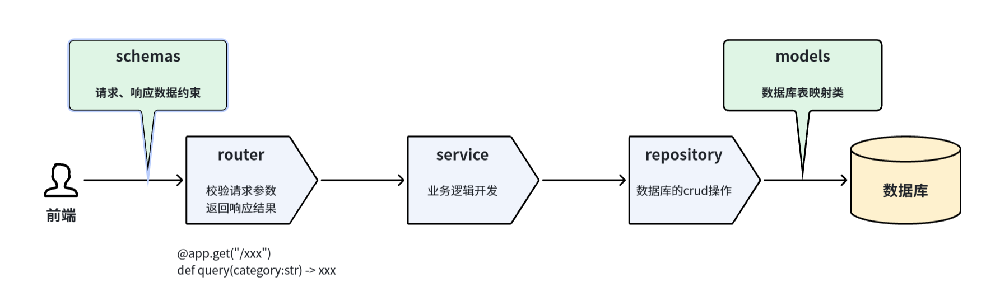

## 学习目标
- 理解项目结构和 pydantic-settings 配置管理
- 能使用 FastAPI 的生命周期管理数据库连接
- 能使用 SqlAlchemy 实现保险查询功能

### 一、项目结构
项目按照职责划分不同的包和模块
- core：核心模块
- infra：基础设施模块
- common：通用模块
- modules：业务模块，主要实现数据库的CRUD以及与前端交互


业务模块再按照处理前端请求的流程划分，通常流程如下图所示：




常见的项目结构有两种：


本项目是按照**业务功能**来划分包结构。

### 二、配置管理 `pydantic-setting`

在开发过程中通常会在项目中用 `.env` 文件来配置项目关键参数，而在部署时才用`系统环境变量`、`命令行参数`来替换

通常我们用 `pydantic-settings` 来管理这些配置，安装依赖
```shell
uv add pydantic-settings
```

配置信息举例
- 项目端口、项目名称
- DeepSeek密钥、Deepseek地址
- 数据库地址、数据库端口、数据库用户名、数据库密码、数据库名
- 日志级别
- ...


#### 2.1 配置加载优先级

如果多种不同的配置同时存在，其加载顺序和优先级如下图：


#### 2.2 配置 `.env`
在项目根目录下创建一个 `.env` 文件，添加如下内容：
```dotenv
# 应用配置
APP_NAME=安心保
APP_DEBUG=true
APP_HOST=0.0.0.0
APP_PORT=8001

# 日志配置
LOGGING_LEVEL=INFO

# 数据库配置
DB_HOST=192.168.150.101
DB_PORT=5432
DB_NAME=insurance
DB_USER=insurance
DB_PASSWORD=insurance123

# 模型配置
DEEPSEEK_API_KEY=your_deepseek_api_key  # 需要替换！！！
CHAT_MODEL=deepseek-v4-flash
```

#### 2.3 配置加载
在 `app.core` 包下创建一个 `config.py` 文件，添加如下内容：
```
见 `app.core.config` 
```

### 三、日志管理
在 `app.core` 包下创建一个 `logging.py` 文件，添加如下内容：
```
见 `app.core.logging` 
```

### 四、项目启动模块

我们在 `app` 包下写一个启动类 `main.py`

启动测试：访问 `http://localhost:8001/docs` ，可以看到 FastAPI 提供的文档

### 五、数据库连接池

#### 5.1 补充连接池配置参数 `echo`、`pool_size`、`max_overflow`、`pool_recycle`
首先，我们在 `app.core.config.py` 中添加数据库连接池相关参数：
```python
class DatabaseSettings(EnvSettings):
    """数据库相关设置"""
    host: str = Field(alias="DB_HOST", default="localhost")
    port: int = Field(alias="DB_PORT", default=5432)
    name: str = Field(alias="DB_NAME", default="insurance")
    user: str = Field(alias="DB_USER", default="insurance")
    password: str = Field(alias="DB_PASSWORD", default="insurance123")
    echo: bool = Field(alias="DB_ECHO", default=False)                         ### 新增
    pool_size: int = Field(alias="DB_POOL_SIZE", default=5)                    ### 新增
    max_overflow: int = Field(alias="DB_MAX_OVERFLOW", default=10)             ### 新增
    pool_recycle: int = Field(alias="DB_POOL_RECYCLE", default=1800)           ### 新增

    @computed_field
    @property
    def url(self) -> str:
        # 自动拼接URL路径
        return PostgresDsn.build(
            scheme="postgresql+asyncpg",
            host=self.host,
            port=self.port,
            username=self.user,
            password=self.password
        ).encoded_string()
```

#### 5.2 统一管理连接池
数据库连接池需要统一管理，然后通过**依赖注入**的方式给每个用户请求分发连接，连接断开后自动释放连接

在项目根目录下新建一个 `app.infra` 包，然后新建一个 `database.py` 文件，添加以下代码
```
见 app.infra.database.py
```

#### 5.2 生命周期管理

由于连接池默认是懒加载，第一次反问才会初始化
所以，我们需要再项目启动时初始化数据库连接池（调用 `check_database`）,在项目停止的时候关闭连接池（调用 `close_db`）

修改 `app.main.py`, 添加下面逻辑

```python
from contextlib import asynccontextmanager

# 生命周期管理（预留）
@asynccontextmanager
async def lifespan(app: FastAPI):
    logger.info(f"【{settings.app.name}】应用启动中...")
    from app.infra.database import check_database, close_database
    try:
        await check_database()
        yield
    finally:
        logger.info("应用关闭中... ")
        await close_database()

app = FastAPI(
    title=settings.app.name,
    debug=settings.app.debug,
    lifespan=lifespan,                
)
```


