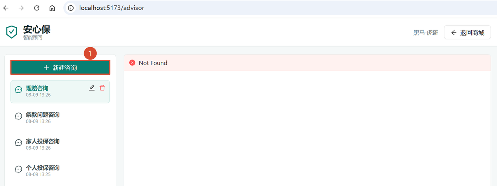
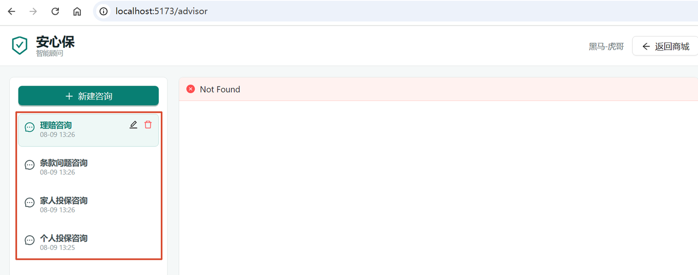
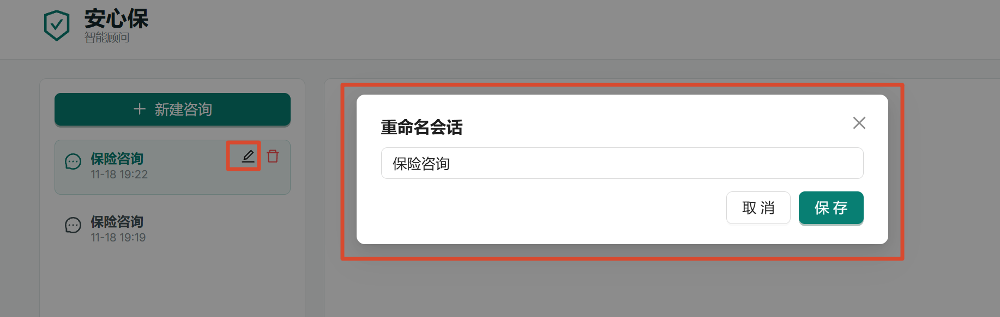
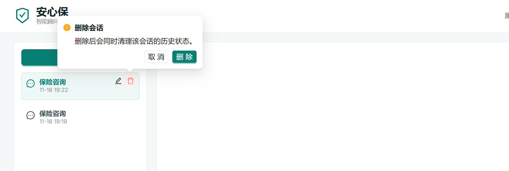

## 一、会话管理功能
用户可以同时拥有多个会话

| 功能 | 请求方式 | 请求路径 |
| :--- | :--- | :--- |
| 创建会话 | POST | `/api/v1/chat-threads` |
| 查询会话列表 | GET | `/api/v1/chat-threads` |
| 重命名会话 | PATCH | `/api/v1/chat-threads/{thread_id}` |
| 删除会话 | DELETE | `/api/v1/chat-threads/{thread_id}` |

会话数据分为两部分
- 会话元数据：所属用户、会话的名称、创建时间、更新时间等信息，存储在 `chat_threads` 表中
- 会话历史消息：属于消息数据，将来用 LangChain 来管理

目前暂时不实现登录功能，前端在每次请求中固定携带 `x-user-id` 请求头，用它模拟当前登录用户，这里默认使用用户 ID `1`，后续接入真实认证时再替换

## 二、接口设计

[会话管理模块](https://my.feishu.cn/wiki/GvHtwszVKiSj2TkJs6lcgrRYn2b)

在 `app/modules` 下新建 `chat_thread` 包，并创建本章需要的文件：

```
app/modules/chat_thread/
├── __init__.py
├── models.py
├── repository.py
├── router.py
├── schemas.py
└── service.py
```

### 创建会话



### 查询会话列表




### 重命名会话



### 删除会话



## 三、统一异常处理
### 定义异常基类
在 `app.core` 包中新建 `exceptions.py` 文件
```python 
class ApplicationError(Exception):
    """应用业务异常基类"""
    status_code: int = 500                # 默认状态码
    code: str = "APPLICATION_ERROR"       # 默认异常code
    message: str = "服务器内部错误"        # 默认异常提示
```

### 改造业务异常处理
修改 `app.modules.chat_thread.exceptions.py`, 让它继承自 `ApplicationError`
```python 
from app.core.exceptions import ApplicationError

class ChatThreadNotFoundError(ApplicationError):
    """会话不存在或不属于当前用户"""
    status_code = 400
    code = "CHAT_THREAD_NOT_FOUND"
    message = "会话不存在或不属于当前用户"
```

### 全局异常处理器
无论异常来自哪个 `Router`，只要它继承自 `ApplicationError`，都会由同一个处理器转换成统一格式的 HTTP 响应

修改 `app.main.py`，导入异常基类 `ApplicationError` 和 `JSONResponse`

```python
from fastapi import FastAPI, Request
from fastapi.responses import JSONResponse
from app.core.exceptions import ApplicationError
```
然后在创建 `FastAPI` 实例之后注册全局异常处理器：
```python
@app.exception_handler(ApplicationError)
async def handle_application_error(
    request: Request,
    exc: ApplicationError, # 捕获到的异常（这里用自定义异常基类捕获，所有业务异常都会匹配到）
) -> JSONResponse:
    return JSONResponse(
        status_code=exc.status_code, # 异常中自带status
        content={
            "code": exc.code,        # 异常中自带code
            "message": exc.message,  # 异常中自带message
        },
    )
```

FastAPI 捕获到 ApplicationError 或它的任意子类后，都会进入这个处理器，再根据异常对象中的字段生成响应。以后新增业务异常时，不需要继续给 `app.main.py` 添加处理器

这只是提供思路，具体实现见
- 定义异常基类和全局异常处理：`app.core.exceptions.py`                 
- 全局异常处理注册：`app.main.py`
- 应用错误继承基类：`app/modules/chat_thread/exceptions.py`

