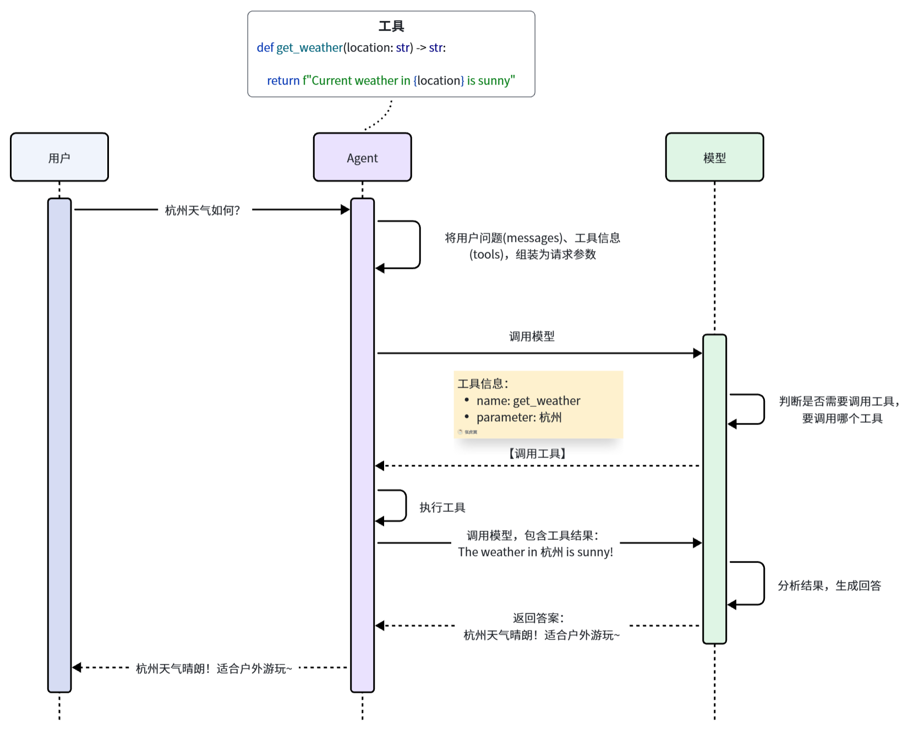

## LangChain 学习目标：
- 知道 `Tool Calling` 原理
- 会使用 LangChain 创建 Agent
- 会使用 LangChain 实现流式输出
- 会使用 LangChain 实现 MCP
- 会使用 LangChain 实现会话记忆


## 一、认识 Agent

### 1.1 什么是 Agent？
**Agent**（通常称为**智能体**或**代理**）是一种能**感知环境、进行自主推理和决策、并调用工具以实现特定目标的智能系统**

Agent = LLM + 规划 + 工具 + 迭代执行 + 记忆

### 1.2 Tool Calling 原理
**工具是在本地自已定义的，而模型则是在服务器上运行的**
> 那么问题来了: 
> - 模型如何知道我们有哪些工具？ ——> （给模型发）函数说明、函数名、函数参数
> - 模型如何调用我们的工具？——> (模型返回) 函数名、函数参数

Tool Calling 技术原理




## 二、认识 LangChain

LangChain是智能体开发平台，包含一套各种帮助开发、测试、部署、评估智能体的框架。核心包括：
- LangChain：用于快速构建智能体，可兼容任何模型提供商。
- LangGraph：从底层一步步控制智能体的构建，包括记忆（Memory）、人机协同（HITL）等
- Deep Agents：用于构建复杂的、处理多步骤的任务的智能体
- LangSmith：用于测试、观察、评估、部署智能体（收费）

## 三、认识 MCP
- **什么是 MCP**： MCP（Model Context Protocol）是一种用于模型和工具之间进行通信的协议。
- **三个核心概念**：
  - `MCP Host`：协调和管理多个MCP客户端的AI应用，比如 LangChain 的 Agent
  - `MCP Client`：连接MCP服务，获取工具信息，供MCP Host使用
  - `MCP Server`：提供MCP服务，可以是远程服务，也可以是本地服务
- 两种通信方式：
  - 以 `stdio` 方式调用 MCP
  - 以 `streamable_http` 方式 调用 MCP


详细的MCP说明可以参考Anthropic公司的MCP官方文档：<br>
https://modelcontextprotocol.io/docs/getting-started/intro <br>
有关通信协议可以查看：<br>
https://modelcontextprotocol.io/specification/2025-11-25/basic/transports


**总结**：MCP 是一个开放协议标准，核心目标是让 AI 应用能以统一的方式连接外部工具，避免重复开发。它采用 Client-Server 架构，Server 端负责暴露工具信息，Client 端负责连接 Server获取工具。

**与 Function Calling 的关系**：MCP 和 Function Calling 是**互补关系**，不是替代关系。Function Calling 解决的是"模型如何表达要调用什么"，MCP 解决的是"工具如何被标准化接入和发现"。MCP Server 暴露的工具，最终仍由模型通过 Function Calling 机制来决定调用

**简单来说**：MCP是一种开放协议，能够让我们在开发AI应用时，标准化地获取工具和调用工具


MCP面试：<br>
https://blog.csdn.net/Yuzhiyuxia/article/details/167221809


LangChian的MCP依赖库
```
uv add langchain-mcp-adapter
```

## 四、会话记忆

### 4.1 短期记忆 vs 长期记忆

| 对比维度 | 短期记忆        | 长期记忆         |
| :--- |:------------|:-------------|
| **生命周期** | 当前会话（短暂）    | 跨任务、跨会话（永久）  |
| **内容** | 会话历史、会话状态   | 知识库、经验、用户偏好  |
| **是否跨任务** | ❌           | ✅            |
| **存储** | Redis/内存/DB | DB/Vector DB |


### 4.2 短期记忆介绍
**短期记忆 =  `State` 中 `messages` 字段 + `Checkpointer` 状态快照 + `thread_id` 会话隔离**
- **AgentState（状态容器）**：本质是一个带 `reducer` 的 `TypedDict`
- **Checkpointer（快照持久化）**：每次与AI交互都会生成一个快照，在 LangChain 中，快照是通过 `Checkpointer` 对象来保存的
- **thread_id**：会话标识，用于区分不同会话

在 LangChain 中， 快照都是通过 `Checkpointer` 对象来保存的，它有很多不同的实现：
- `InMemorySaver`：基于内存存储
- `SqliteSaver`：基于 sqlite 数据库存储
- `PostgreSaver`：基于 PostgreSql 数据存储


