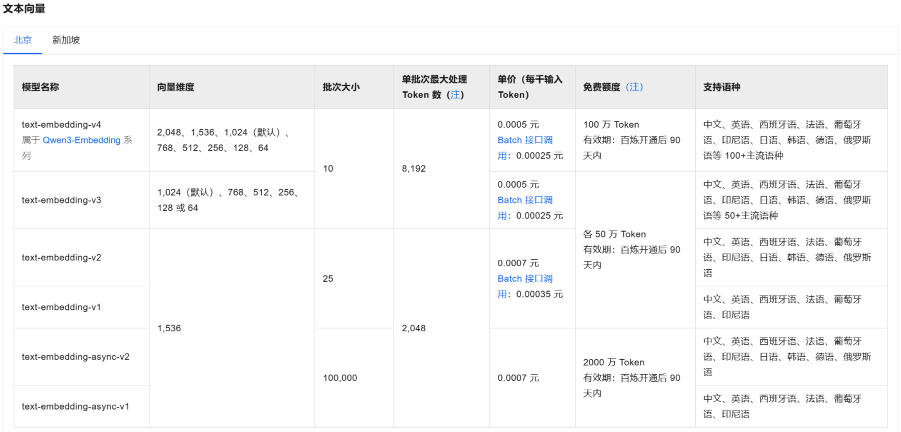
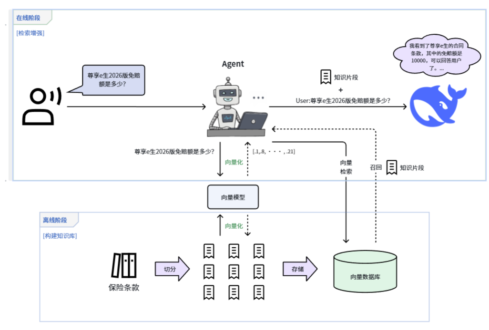

## 一、认识 RAG

RAG，Retrieval-Augmented Generation，就是检索增强生成的意思。既，通过检索加载额外的知识作为上下文信息来增强LLM的生成回答。

### 1.1 大模型局限
- 幻觉
- 时间截止
- 知识限制

### 1.2 知识切分
文档切块：解决知识库过大，可能存在两个问题：① 超出模型上线限制；② 浪费大量 Token，成本高

### 1.3 知识检索
文档检索： 如何从海量的知识片段中找到与用户问题最相关的片段 -> 语义分析 =  向量模型 + 向量相似度

#### 向量模型

#### 向量相似度
- 余弦相似度
- 欧式距离
- 点积

#### 向量数据库
- 存储向量数据
- 构建索引高效检索向量数据

LangChain中支持市面上常见的各种向量数据库，具体可查看官方文档： 
https://docs.langchain.com/oss/python/integrations/vectorstores

新兴专用向量数据库：

| 数据库名称 | 核心特点 | 典型企业场景 |
| :--- | :--- | :--- |
| Pinecone | 全托管、无需运维、索引优化强 | 适合不希望管理基础设施的SaaS公司、初创企业。 |
| Milvus | 最流行的开源向量数据库，功能全面（支持多种索引、混合查询）。 | 适合有数据安全要求、需要自建或私有化部署的中型企业。 |
| Qdrant | 用Rust编写，性能极高，支持丰富的过滤条件（Payload）。 | 适合需要复杂元数据过滤的场景（如电商、社交推荐）。 |
| Weaviate | 内置ML模型（可直接向量化数据），支持GraphQL接口。 | 适合希望简化数据预处理流程、使用GraphQL的团队。 |
| Chroma | 轻量级、嵌入式使用（类似SQLite），与LangChain集成最紧密。 | 适合原型验证、AI应用快速开发、个人/小团队项目。 |

传统数据库新增向量功能：

| 产品名称 | 向量功能特点 | 常见用途 |
| :--- | :--- | :--- |
| Elasticsearch | 通过 `dense_vector` 字段和 `knn` 查询支持向量搜索。 | 已有ES集群的企业、日志+向量混合搜索场景。 |
| Pgvector (PostgreSQL扩展) | 最流行的关系型数据库向量扩展，简单稳定，支持精确/近似搜索。 | 技术栈以PostgreSQL为主、不想引入新组件的企业。 |
| Redis | 通过 RedisSearch 模块提供向量相似度搜索。 | 需要超低延迟（缓存级）、实时推荐场景。 |
| ClickHouse | 通过余弦/欧氏距离函数支持向量检索。 | 大规模数据分析+向量检索结合的OLAP场景。 |

### 1.4 RAG 整体流程
**RAG**，**R**etrieval-**A**ugmented **G**eneration，关键词：
- **检索**：就是利用向量相似度检索知识片段
- **增强**：用检索到的知识片段增强模型，减少幻觉
- **生成**：模型基于知识片段生成答案

RAG分为两大阶段：
- **离线阶段**：负责构建知识库
  1. **知识加载**：读取各种来源的知识库数据，解析、清洗数据，形成文档（Documents）。
  2. **知识切分**：把清洗后的知识文档切分成一个个的知识片段（Chunks）
  3. **向量化**：利用向量模型将知识片段转为向量，使得语义相近的文本在该向量空间中彼此邻近
  4. **存储向量**：将处理好的向量及对应的知识片段存入向量数据库
- **在线阶段**：负责检索知识，生成回答
  1. **问题向量化**：利用向量模型（必须与离线阶段同一个模型）将用户问题转为向量
  2. **知识召回**：在向量数据库中检索与问题向量最相似的文档的TopN
  3. **生成回答**：把检索到的知识片段与用户提问组织为新提示词，发给大模型，生成回答

### 1.5 LangChain 的 RAG 组件
LangChain 为了简化 RAG 的开发，为我们提供了大量组件，满足 RAG 每一个流程的实现。

主要的组件包括：
- **离线阶段**
  1. **知识加载**：LangChain提供了 `Document Loader` 组件
  2. **知识切分**：LangChain提供了 `Text Splitter` 组件
  3. **向量化**：LangChain提供了 `Embeddings` 接口，兼容各类向量模型
  4. **存储向量**：LangChain提供了 `VectorStore` 接口，兼容各类向量数据库
- **在线阶段**：负责检索知识，生成回答
  1. **问题向量化**：同样基于 `Embeddings` 模型接口
  2. **知识召回**：LangChain提供了 `VectorStore` 组件，简化知识片段的检索操作
  3. **生成回答**：拼接召回知识片段和用户问题，调用模型即可