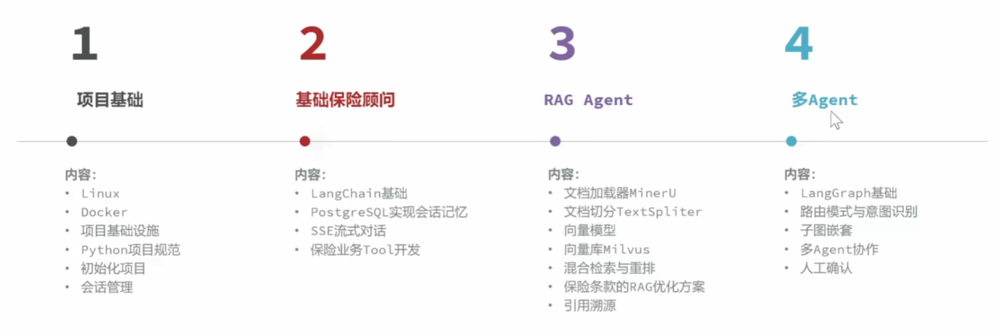

本课程基于Python语言，从零搭建一个基于FastAPI的Agent项目。以项目为载体，学习LangChain、LangGraph框架， 
以及RAG、Agent项目的设计思路、开发规范、核心技术。
涵盖MinerU文档解析、Milvus向量库、稠密和稀疏混合检索、融合重排、多Agent编排、Agent状态管理等各种细节。

「**安心保**」是一个面向个人或家庭的在线保险商城，其中功能分为两个部分
- 保险商城：提供保险产品浏览、保费的测算、投保、保单的管理和理赔等服务
- 保险智能顾问：考虑到大部分用户对保险产品是缺少了解的，并且投保和理赔的流程也是比较陌生的，
因此开发了保险智能顾问，来借助于大模型，通过自然语言， 帮助用户去理解产品和产品条款，配置保险方案，甚至执行帮助用户完成理赔的流程

